# Sign Language Learning and Practice Platform

A web-based sign language learning application built with React and MediaPipe. The platform uses webcam input to recognize supported hand gestures and provides practice and test workflows with visual feedback. Its goal is to make sign-language practice interactive and accessible through a browser.

## Overview

The application combines browser-based webcam capture, MediaPipe gesture recognition, and interactive learning workflows. The bundled gesture-recognition model is intended to recognize 41 configured classes: 25 alphabet entries (A–Y, excluding Z) and 16 word/sign classes. Recognition results depend on the supported classes, camera conditions, hand positioning, and model performance. No accuracy percentage is claimed here because a reproducible evaluation result has not been documented.

## Key Features

Real-Time Gesture Recognition: Instantaneous recognition of hand gestures using MediaPipe's advanced hand tracking and gesture recognition models.

Interactive Learning System: Three-tier learning approach with guided instruction, hands-on practice, and assessment testing.

Progress Dashboard: View practice activity and available progress statistics.

Recognition Feedback: Displays gesture-recognition results and confidence-related feedback to help users practice supported signs.

User Authentication: Supports email/password authentication and Google sign-in through the configured authentication services.

Confidence Feedback: Displays recognition confidence information to support practice and test workflows.

Responsive Interface: Intuitive and accessible user interface designed for users of all technical skill levels.

Practice and Test Results: The interface includes practice and test workflows, with progress or performance information where supported by the application.

## Technical Architecture

### Front-End Stack

React: Modern JavaScript library for building interactive user interfaces

Redux: State management for predictable application state

React Router: Client-side routing for seamless navigation

Webcam Integration: Real-time video capture and processing

## Back-End Stack

Supabase: PostgreSQL database with real-time capabilities for user data and feedback storage

Google OAuth: Secure authentication and user identity management

## Machine Learning Framework

MediaPipe Tasks Vision: Runs the bundled gesture-recognition task in the browser

Hand Support: The recognizer is configured to process up to two hands

Gesture Classes: The bundled model is documented as containing 41 classes: 25 alphabet entries (A–Y, excluding Z) and 16 word/sign classes. These class counts describe the model labels, not a measured accuracy guarantee.

## Installation and Setup

### Prerequisites

Node.js and npm installed on your system
A Supabase account and project
Google OAuth credentials
Modern web browser with webcam access

### Installation Steps

1. Clone the repository
   ```bash
   git clone https://github.com/NiteeshGowda72/Sign_Language_Learning_Platform.git
   cd Sign_Language_Learning_Platform
   ```

2. Install dependencies
   ```bash
   npm install
   ```

3. Configure environment variables
   Create a `.env` file in the root directory with the following variables:
   ```
   REACT_APP_SUPABASE_URL=your_supabase_url
   REACT_APP_SUPABASE_ANON_KEY=your_supabase_anon_key
   REACT_APP_GOOGLE_CLIENT_ID=your_google_client_id
   ```

4. Start the development server
   ```bash
   npm start
   ```

5. Open your browser and navigate to http://localhost:3000

## Application Features and Workflow

### Home Page

Welcome screen with options to choose between Practice and Test learning modes.

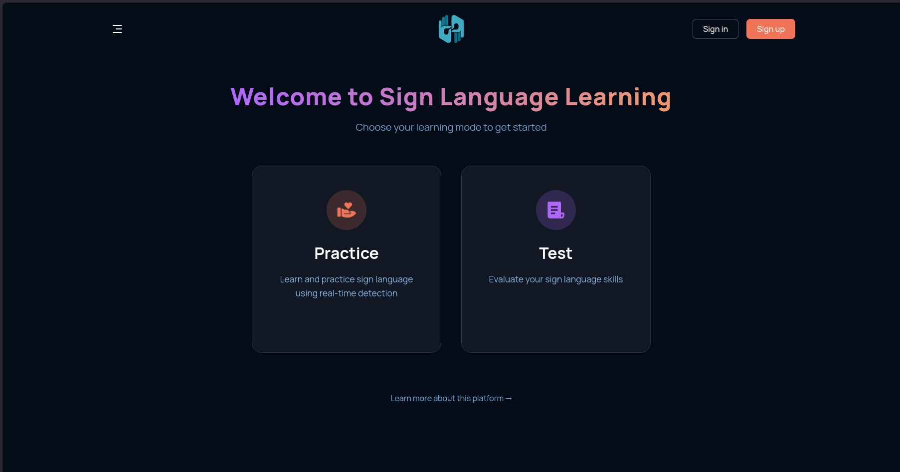

### User Registration

User account creation page with Google OAuth integration for seamless signup.

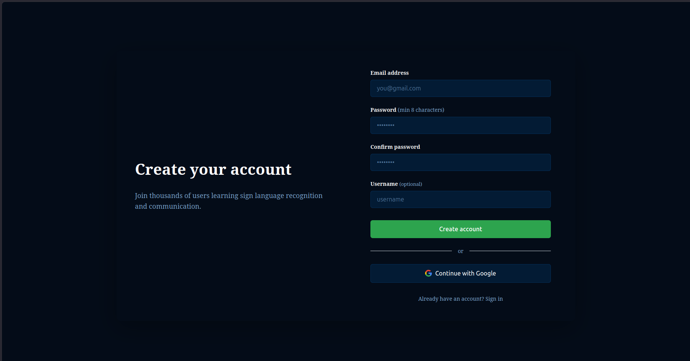

### User Login

Secure login interface with email and password authentication or Google login option.

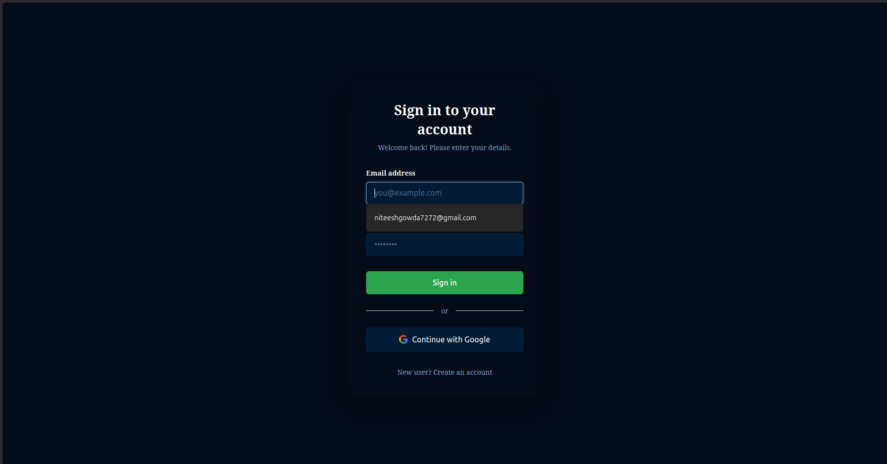

### Practice Mode Instructions

Clear instructions for the practice session with timing requirements and success criteria.

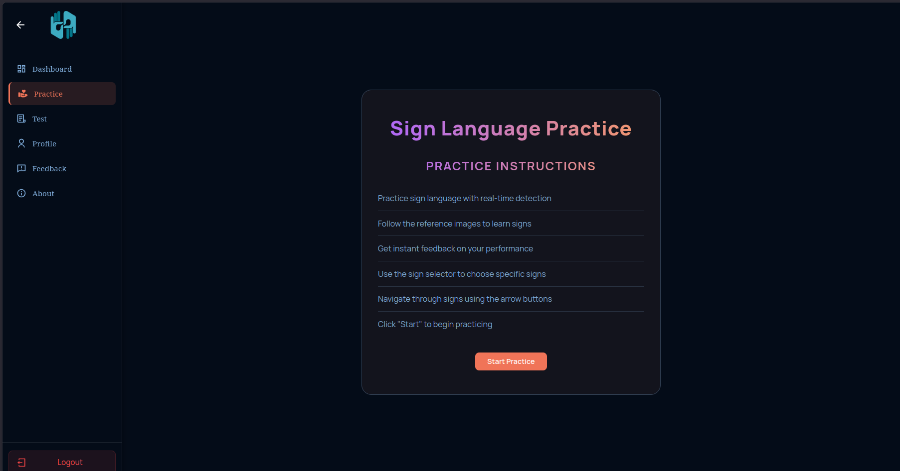

### Practice Mode – Sign "C" Detection in Progress

Live webcam feed with hand gesture visualization, real-time sign detection showing countdown timer.

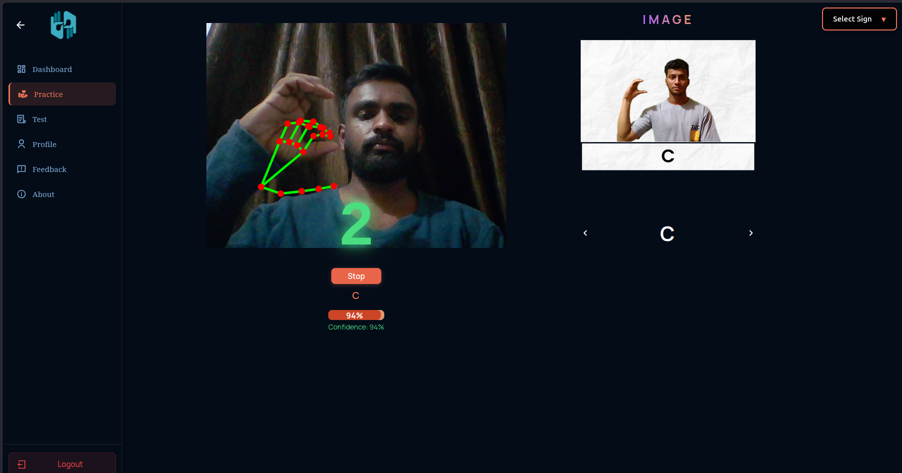

### Practice Mode – Sign "Thank You" Recognition

Practice mode gesture recognition showing the Thank You sign.

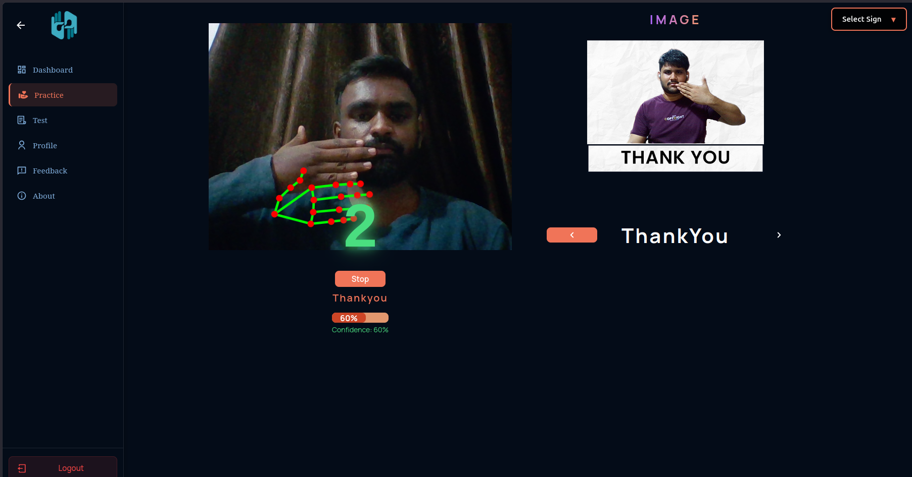

### Practice Mode – Sign "Bye" Recognition

Practice mode gesture recognition showing the Bye sign.

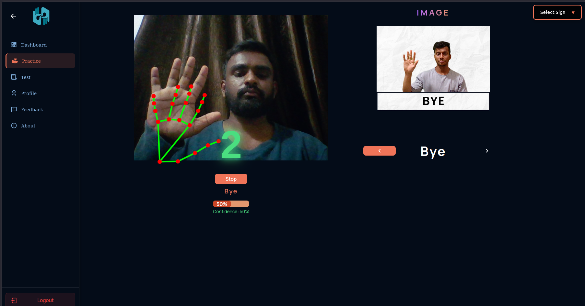

### Practice Mode – Sign "E" Successfully Completed

Practice mode confirmation screen showing successful sign completion for a selected gesture.

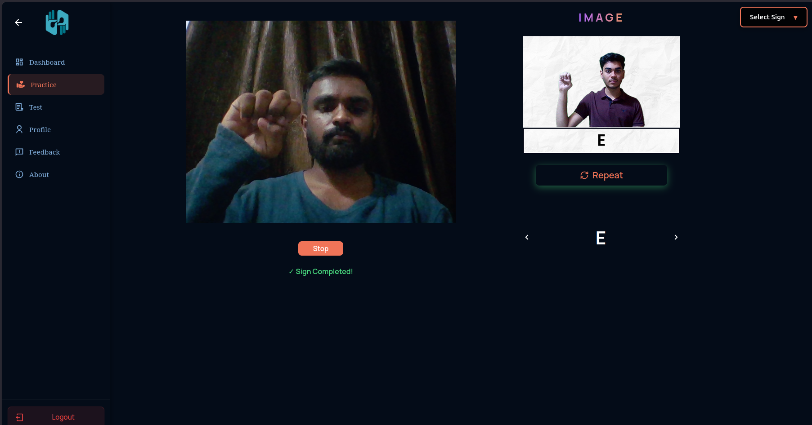

### Test Instructions

Detailed instructions for the 10-sign test with timing requirements and success criteria.

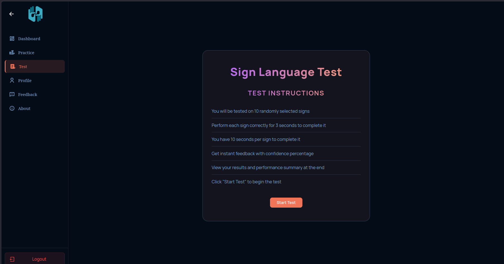

### Sign Language Test Interface

Organized test interface showing 10 signs to practice with real-time detection and completion tracking.

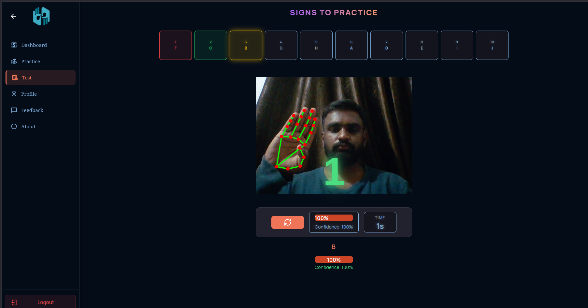

### Dashboard & Activity Analytics

User activity dashboard showing performance analytics and progress statistics.

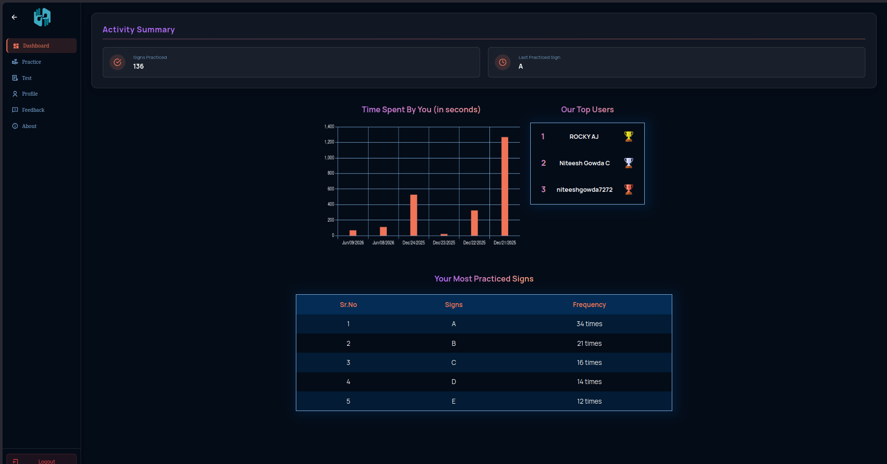

### User Profile

Comprehensive profile page displaying user information, account details, and progress statistics including total signs practiced, tests taken, best score, and accuracy metrics.

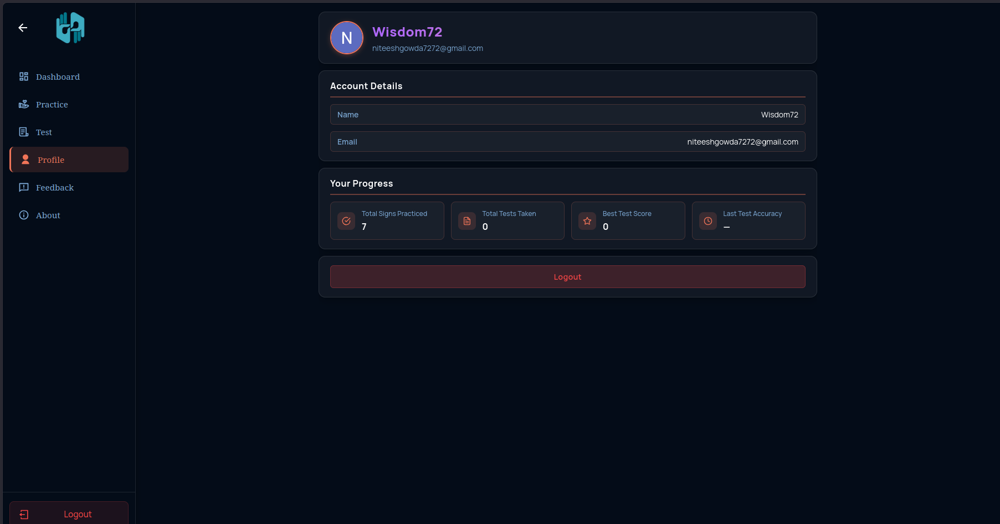

## Project Technology Stack

### Frontend Dependencies

@mediapipe/drawing_utils: Utilities for visualizing hand landmarks
@mediapipe/hands: Hand detection and tracking
@mediapipe/tasks-vision: Vision task framework
@react-oauth/google: Google authentication
@supabase/supabase-js: Supabase client library
chart.js and react-chartjs-2: Data visualization
react-redux: Redux bindings for React
react-router-dom: Client-side routing
react-webcam: Webcam component
uuid: Unique identifier generation
react-toastify: Notification system

## Developer Information

Developer: Niteesh Gowda C
Email: niteeshgowda7272@gmail.com
GitHub: https://github.com/NiteeshGowda72

## Project Repository

GitHub Repository: https://github.com/NiteeshGowda72

## Reference Documentation

MediaPipe Gesture Recognition: https://developers.google.com/mediapipe/solutions/vision/gesture_recognizer

Supabase Documentation: https://supabase.com/docs

Google OAuth Documentation: https://developers.google.com/identity/protocols/oauth2

## File Structure

The model training file is located in the root folder. The pre-trained gesture recognition model (sign_language_recognizer_25-04-2025.task) is located in the src/assests directory.

Model File: `src/assests/sign_language_recognizer_25-04-2025.task`

## License

This project is provided as-is for educational and research purposes.

## Acknowledgements

Special thanks to the open-source community for the tools and libraries that made this project possible.

- React: https://react.dev/
- MediaPipe: https://developers.google.com/mediapipe
- Supabase: https://supabase.com/
- Google OAuth: https://developers.google.com/identity/protocols/oauth2

## MediaPipe Runtime Configuration

The application uses a pinned MediaPipe Tasks Vision runtime matching the
installed `@mediapipe/tasks-vision` dependency. The runtime and gesture-recognition
options are centralized in `src/config/vision.js`.

The runtime URL is centralized in:

`src/config/vision.js`

This avoids relying on a moving `@latest` CDN runtime.

The sign recognition model is loaded from:

`src/assests/sign_language_recognizer_25-04-2025.task`
